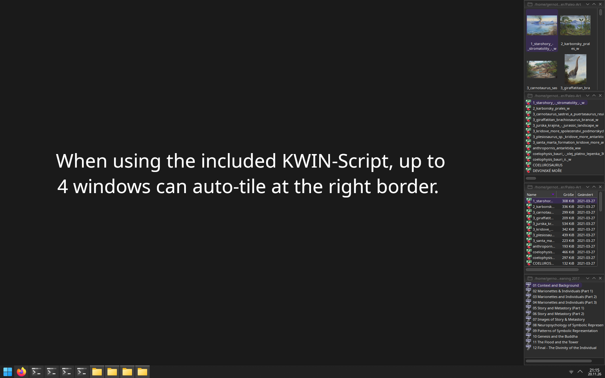
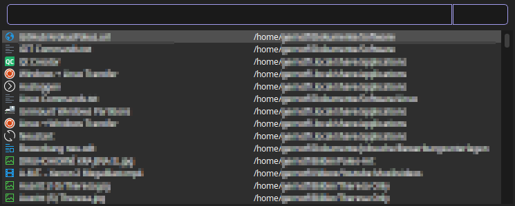
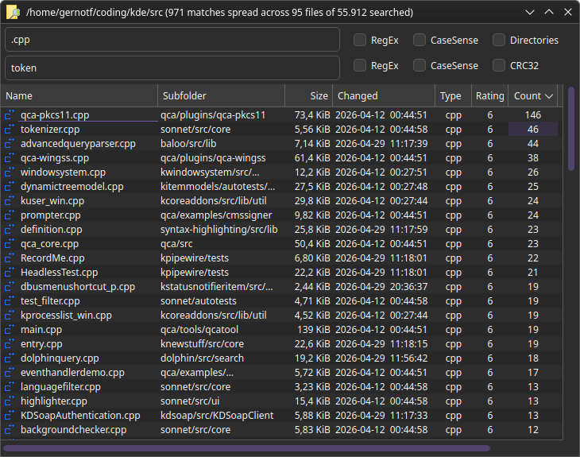
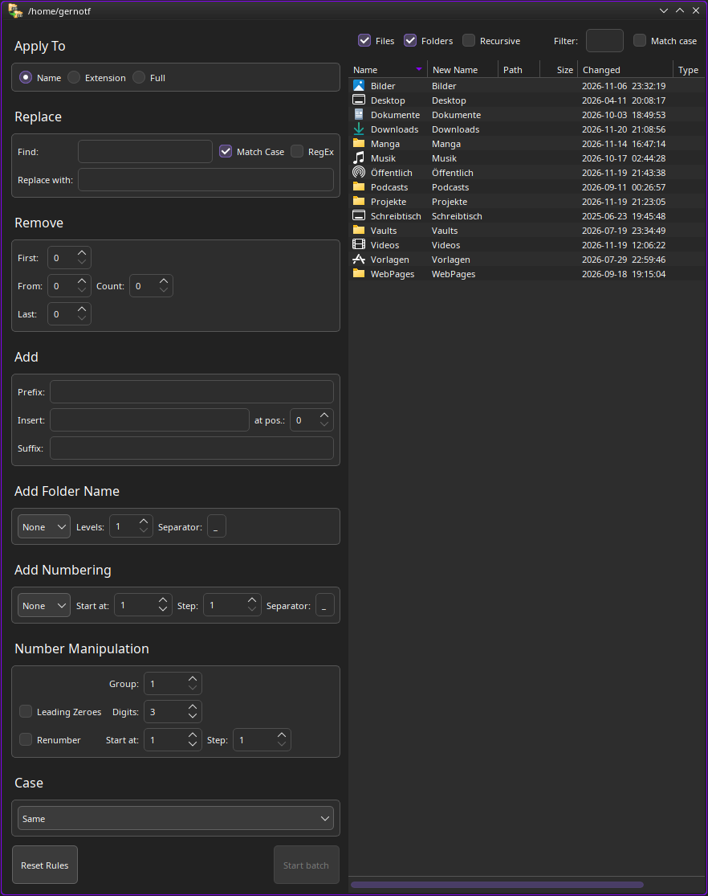

# mkFileTools

A collection of Qt6 desktop tools, created out of various frustrations with existing Linux GUI apps:
a file manager, an anything launcher, a file search, a batch renamer, and two KWin scripts.

The tools are minimalist and screen-space efficient, and meant to be used with mouse and keyboard.
Definitely no touch friendliness here: think hotkeys, not buttons.
They are Linux apps, developed on KDE Plasma.

| Tool | Purpose |
|------|---------|
| [mkFolderWidget](#mkfolderwidget) | Compact file manager |
| [mkLauncher](#mklauncher) | Launcher for apps and files |
| [mkFileSearch](#mkfilesearch) | File search by name and content |
| [mkBatchRename](#mkbatchrename) | Batch renaming of files |
| [mkTransactionHandler](#mktransactionhandler) | Copy/move/delete helper for mkFolderWidget |
| [KWin scripts](#kwin-scripts) | Window tiling and placement (KDE Plasma only) |

## mkFolderWidget



A minimalist file manager optimized to take up as little space as possible. Together with the included KWin script
[mkFolderWidget Tiler](#kwin-scripts), its windows are tiled in a narrow column at the right side of the screen.

```
mkFolderWidget [directory] [-f <file to focus>] [-X <x> -Y <y> -W <width> -H <height>]
```

## mkLauncher



A launcher for apps and files that does not use an indexing service.

## mkFileSearch



A file search tool that does not use an indexing service. It searches by file name and/or content, with plain
search terms or regular expressions.

```
mkFileSearch [path]
```

Without an argument it searches the home folder. The intended workflow is to start it with the folder to search,
either from a file manager that can launch external programs this way, or via a global shortcut.

The following script is an example for a shortcut such as Meta+F. It takes the path from the title bar of the
active window (if it shows one) and opens mkFileSearch there. mkFolderWidget shows its full path in the title bar by
default; for other file managers such as Dolphin you may have to enable that option.
It needs `kdotool` on Wayland or `xdotool` on X11.

<details>
<summary>mkFileSearch-here.sh</summary>

```bash
#!/bin/bash
# Opens mkFileSearch in the folder shown in the title bar of the active window.

if [ "$XDG_SESSION_TYPE" = "wayland" ]; then
    TOOL="kdotool"
else
    TOOL="xdotool"
fi

WINDOW_ID=$($TOOL getactivewindow)
FULL_TITLE=$($TOOL getwindowname "$WINDOW_ID")

# "<label>:<path> — <app>"
regex1="^[^:]+:(.*) — .*$"
# "<file name> @ <path> — <app>"; [^@]* stops at the first "@" (.* would be greedy and read up to the last one)
regex2="^([^@]*) @ (.*) — .*$"

if [[ "$FULL_TITLE" =~ $regex1 ]]; then
    TITLE_PATH="${BASH_REMATCH[1]}"
elif [[ "$FULL_TITLE" =~ $regex2 ]]; then
    TITLE_PATH="${BASH_REMATCH[2]}/${BASH_REMATCH[1]}"
else
    # Dolphin: "<path> — Dolphin" (note the em dash)
    TITLE_PATH="${FULL_TITLE% — Dolphin}"
fi

CLEAN_PATH="${TITLE_PATH/#\~/$HOME}"

if [ -d "$CLEAN_PATH" ]; then
    TARGET_PATH="$CLEAN_PATH"
elif [ -f "$CLEAN_PATH" ]; then
    TARGET_PATH=$(dirname "$CLEAN_PATH")
else
    TARGET_PATH="$HOME"
fi

mkFileSearch "$TARGET_PATH" &
```

</details>

## mkBatchRename

Renames many files at once: find and replace (optionally case-sensitive or with regular expressions), remove,
move or copy parts of the name, add prefix/suffix, folder name or numbering, pad or renumber existing numbers,
and change case. The rules apply to the name, the extension or both; the file list shows the resulting names before
anything is renamed.

```
mkBatchRename [folder]
```


## mkTransactionHandler

A helper without its own launcher entry: mkFolderWidget starts it to copy, move and delete files in a separate
process, with progress display and conflict dialogs. On Linux it can optionally hand the operations over to KIO,
so that progress is shown in the Plasma notification area.

## KWin scripts

Two scripts for KDE Plasma 6, enabled under *System Settings → Window Management → KWin Scripts*:

- **mkFolderWidget Tiler** tiles mkFolderWidget windows into a column at the right screen border.
- **Window placement: Next to active** places new windows right next to the active one, if there is enough space.

They are installed together with the apps. To install only the scripts into your user folder, run
`./kwin-scripts-install.sh` (remove them again with `./kwin-scripts-remove.sh`).

## Requirements

- Qt ≥ 6.5 (Core, Widgets, Concurrent, DBus, Network, LinguistTools), CMake ≥ 3.19, a C++20 compiler, zlib
- On Linux additionally KDE Frameworks 6 KIO
- For the KWin scripts: KDE Plasma 6

On Arch Linux:

```bash
sudo pacman -S --needed base-devel cmake qt6-base qt6-tools kio zlib
```

## Building and installing

```bash
git clone https://github.com/KrokusPokus/mkFileTools.git
cd mkFileTools
cmake -B build -DCMAKE_BUILD_TYPE=Release -DCMAKE_INSTALL_PREFIX=/usr
cmake --build build --parallel
sudo cmake --install build                   # installs system-wide
sudo xargs rm < build/install_manifest.txt   # uninstalls again
```

For development, `./build.sh` builds into `build/` without installing, and `./build_lupdate.sh` updates the
translation sources in `i18n/*.ts`.

> **Note:** add `-DMK_NATIVE=ON` to optimize for your CPU (`-march=native`, `./build.sh` does this). The binaries
> may then not run on other CPUs.

## License

GPL-3.0-only, see [LICENSE](LICENSE).
